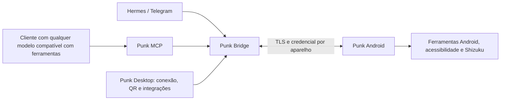

# Punk Desktop e MCP: conexão sem terminal

## Estado desta entrega

- **Implementado em 3.5.2:** painel local Windows, aberto com duplo clique em `ABRIR-PUNK.vbs`, com estado do PC/celular/Hermes/ADB e botões para conectar e gerar o QR. Usa a instalação Hermes já provisionada e mantém o bridge em execução ao fechar a janela.
- **Implementado em 3.5.2:** Live por turnos com captura suspensa durante o TTS e intervalo de 900 ms após o término/interrupção. A interrupção é manual; o detector baseado apenas em volume foi retirado do fluxo ativo.
- **Projeto abaixo, ainda não implementado:** servidor MCP, instalador autossuficiente, descoberta automática, credenciais individuais de clientes MCP e configuração visual desses clientes.

## Experiência desejada

1. Instalar **Punk Desktop** por um instalador assinado e abrir o aplicativo.
2. Escolher **Usar meu Hermes** ou conectar outro agente compatível.
3. Tocar **Conectar celular**. O PC mostra um QR com endereço e identidade criptográfica; o aplicativo Android lê uma vez e guarda sua credencial no Keystore.
4. Ver os aparelhos conectados e os recursos disponíveis. Acessibilidade, notificações e Shizuku continuam com seus fluxos de autorização Android.
5. Abrir **Integrações**, escolher um cliente MCP e clicar **Conectar**. Cada cliente recebe sua própria credencial revogável.
6. Reiniciar o PC ou trocar de rede sem refazer o pareamento; a aplicação tenta reconectar e informa se o PC está indisponível ou se a identidade mudou.

O usuário não copia tokens, endereços IP, comandos Python ou JSON. As credenciais continuam existindo para autenticar as conexões, mas sua geração, armazenamento e renovação passam a ser responsabilidade do produto.

## Arquitetura

O MCP padroniza a interface de ferramentas; não é um modelo e não confere privilégios além dos disponíveis ao aplicativo Android. Clientes sem suporte a MCP precisarão de um adaptador. O Hermes continua responsável pelo próprio contexto, memória e conversa quando usado como agente.

## Contrato MCP proposto

| Ferramenta | Resultado |
| --- | --- |
| `punk_devices` | Aparelhos, conexão, versão, permissões e capacidades reais. |
| `punk_tools` | Catálogo filtrado por dispositivo, schemas e classificação das ações. |
| `punk_execute` | Executa uma ferramenta no dispositivo escolhido, com `callId`, prazo e resultado confirmado. |
| `punk_call_status` | Consulta uma chamada já recebida, evitando repetir uma ação após queda de conexão. |
| `punk_events` | Eventos desde um cursor, incluindo atividades e mudanças observáveis. |
| `punk_files` | Transferências com progresso, retomada e hash, conforme capacidades concedidas. |
| `punk_cancel` | Solicita parada de uma execução específica e distingue solicitação de confirmação. |

O modelo deve descobrir o schema antes de chamar ferramentas. Para clientes que funcionam melhor com ferramentas individuais, o servidor pode anunciar o catálogo nativo com schemas próprios e nomes prefixados por `punk_`.

Primeiro transporte: **stdio local**, lançado pelo próprio cliente MCP. O processo lê a credencial privada do cliente no PC, sem incluí-la na configuração exportada nem na conversa. Depois: Streamable HTTP com autenticação própria para clientes remotos. O token administrativo atual do bridge não deve ser distribuído aos clientes.

Cada resultado preserva `ok`, `status`, `callId`, erro e origem. `timeout` significa resultado desconhecido até consulta; não é autorização para repetir instalação, envio de mensagem ou outra ação com efeito externo. O SDK oficial permite schemas de ferramentas e indicação de erro no resultado.

## Conexão e credenciais

- O Desktop cria o pedido de pareamento com prazo curto e uso único; a identidade TLS do PC permanece estável.
- A leitura do QR troca esse pedido pela credencial individual do aparelho, guardada automaticamente.
- O Desktop mantém credenciais de integrações no cofre do Windows e oferece revogação por cliente/aparelho.
- Descoberta mDNS encontra o PC na rede local; QR continua sendo o caminho inicial e o fallback. A identidade criptográfica, e não o IP, identifica o computador.
- Tailscale pode fornecer a rota remota quando já disponível; o MVP não depende de conta ou banco em nuvem.
- Uma fila por dispositivo/conversa evita que dois agentes disputem toques, fala ou edição. Eventos recebidos são dados e nunca entram automaticamente como instruções do agente.

## Sequência recomendada

1. **3.5.2 — estabilidade e primeiro painel:** correção de eco e painel para instalações já configuradas, entregues neste patch.
2. **3.6 — instalação e conexão:** instalador com dependências próprias, assistente visual de provisão Hermes, descoberta de PC e reconexão; nenhum terminal no fluxo normal.
3. **3.7 — MCP:** catálogo, execução, acompanhamento/cancelamento, credencial por cliente e integração visual. Testar com dois clientes MCP e modelos diferentes.
4. **3.8 — experiência e operação:** retomar o chat profissional e a linha do tempo de atividades, com diagnóstico de concorrência e latência entre agentes/dispositivos.

O instalador só deve ser chamado de plug and play após testes em um Windows limpo sem Python, Android SDK ou Hermes pré-configurados. O painel desta versão simplifica a instalação pessoal existente; não substitui essa validação.

Referências: [SDK oficial Python MCP](https://github.com/modelcontextprotocol/python-sdk), [especificação MCP](https://modelcontextprotocol.io/specification/latest).
